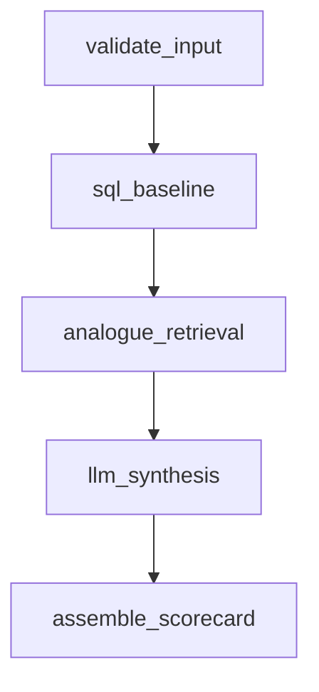

# RAGS2Riches

A local-first **deal intelligence engine** for commercial leasing. Give it a prospective deal (industry, size, lease term, property) and it returns a structured scorecard: an estimated fee, comparable historical deals, effort allocation, a closing playbook, and an explicit list of what the data could not support.

It combines two kinds of evidence, following the hybrid design in [`deal_intelligence_engine_build_guide.md`](deal_intelligence_engine_build_guide.md):

- **Statistical baseline** from SQL over historical deals (medians and quartiles, not means, because fees are right-skewed).
- **Analogue retrieval** using a pure-Python TF-IDF cosine search over structured deal features. No embedding service is needed.

An LLM, if you choose one, only writes the narrative. **Every number on the scorecard is computed locally and is never taken from the model.**

> **Status: prototype.** Thresholds for the pursue recommendation, effort tiers, hours and confidence level are uncalibrated placeholders. See [Limitations](#limitations).

## Contents

- [What's in this repo](#whats-in-this-repo)
- [Quick start](#quick-start)
- [Workflow](#workflow)
- [Configuration](#configuration)
- [LLM providers](#llm-providers)
- [API](#api)
- [Input data](#input-data)
- [Privacy and security](#privacy-and-security)
- [Limitations](#limitations)
- [Tests](#tests)
- [Project layout](#project-layout)

## What's in this repo

| Component | Path | Purpose |
|---|---|---|
| **RAGS2Riches engine** (main) | `app/` | FastAPI + LangChain/LangGraph service over a leasing ledger (`.xlsx`), with a live-streaming UI. |
| **Deal Copilot** (standalone demo) | `deal_copilot/` | Dependency-free, stdlib-only scorer over a small sample dataset, packageable as a single Windows `.exe`. |

The two are independent and do not share code or data.

## Quick start

### Easiest on Windows: double-click

There is one launcher, `launcher.py`, started through `RAGS2Riches.bat`:

- **`RAGS2Riches.bat`**: on first run it creates `.venv` and installs the requirements (this can take several minutes). It then starts the server on the first free port from 8000 to 8010 and opens the app in a native window, falling back to your default browser if pywebview is unavailable. Closing the window stops the server. Data (the SQLite database and `uploads/`) is kept in `data/`, and logs go to `data/launcher.log`.
- **`RAGS2Riches.bat build`**: also writes `dist\RAGS2Riches.exe` with PyInstaller. The exe runs the same `launcher.py` with no Python install needed, and bundles the workbook (from `SOURCE_XLSX`, or `Downloads\mock leasing data.xlsx` by default) so the database can be seeded on first start.

### Manual setup

Requires Python 3.12.

**Windows (PowerShell)**

```powershell
py -3.12 -m venv .venv
.venv\Scripts\python.exe -m pip install -r requirements.txt
$env:SOURCE_XLSX = "C:\path\to\your leasing data.xlsx"
.venv\Scripts\python.exe -m uvicorn app.api:app --reload
```

**macOS / Linux**

```bash
python3.12 -m venv .venv
.venv/bin/python -m pip install -r requirements.txt
export SOURCE_XLSX="/path/to/your leasing data.xlsx"
.venv/bin/python -m uvicorn app.api:app --reload
```

Open <http://127.0.0.1:8000>. On first start, if the database is empty and `SOURCE_XLSX` exists, the workbook is ingested automatically into a local SQLite file (`data/deals.db`).

The default provider is `template`, which needs no model, network or API key.

> The source workbook is **not** included in this repository. Without one, the app starts with an empty database and every deal will report that no comparables were found. See [Input data](#input-data) for the expected columns.

## Using the app

The web page is written for non-technical users and leads them step by step. Open it and choose one of three things:

| Choice | What happens |
|---|---|
| **Check a new deal** | A four-step form (the client, the space, anything else, review). Every field can be skipped, with examples and friendly checks. Progress shows live ("Finding deals like this one..."), then an answer page opens. |
| **Learn from a past deal** | Search and pick a deal from your records. It is checked as if new, then compared with what really happened. |
| **The big picture** | Portfolio statistics in plain language: data completeness, typical fees, income by business type and size, dependence on a few clients, leases ending soon, clients who came back, unbilled fees, seasonality and agent volumes. |

The answer page puts the answer first: a one-sentence headline with a range, how much to trust it (and why), what to do next, similar deals with the reasons they match, risks, and *what we couldn't tell you, and why*. A feedback strip records whether it was useful and what really happened (WON, LOST, DROPPED), which is the data needed to estimate win probability later. The technical trace (steps, timings, raw JSON) is behind "Show me how this was worked out".

On first run with no records, the home page offers to load an Excel file from the user's computer. The design rationale is in [`design/guided-ux.md`](design/guided-ux.md).

## Workflow

Each evaluation runs as a LangGraph state graph. The UI streams every node's start, end, duration and errors live over Server-Sent Events.



| Node | What it does |
|---|---|
| `validate_input` | Validates and normalises the deal; derives size tier and lease-term band. Zero is treated as missing. |
| `sql_baseline` | Finds comparables, widening the match until at least 5 are found: industry + size tier, then size tier, then industry, then all deals. Reports median fee, quartiles, size, term and win rate. |
| `analogue_retrieval` | Returns the top 5 similar deals by TF-IDF cosine similarity. A match must share an industry, size tier or property feature and score at least 0.15. |
| `llm_synthesis` | Produces the narrative via the chosen provider, using a redacted payload. Falls back to a template narrative if the provider fails. |
| `assemble_scorecard` | Combines everything into the final scorecard, including `data_gaps` and `warnings`. |

### Scorecard

The scorecard contains `qualification`, `estimates`, `effort_allocation`, `closing_playbook`, `evidence` (baseline and analogues), `data_gaps`, `warnings`, and `narrative_source` (`llm`, `template` or `template_fallback`).

Fields the data cannot support are `null` rather than guessed. For example, win probability is `null` when the source has no WON/LOST outcomes, and the narrative is rejected and replaced if an LLM quotes a win percentage anyway.

## Configuration

All settings are environment variables.

| Variable | Default | Description |
|---|---|---|
| `SOURCE_XLSX` | a developer-local path (see note) | Workbook to ingest. **Set this explicitly.** |
| `DATABASE_URL` | `sqlite:///data/deals.db` | SQLAlchemy database URL. |
| `INGEST_DIR` | `data/uploads` | Directory from which `/api/ingest` may read `.xlsx` files. |
| `ALLOWED_HOSTS` | `localhost,127.0.0.1,testserver` | Comma-separated `Host` headers accepted. |
| `LLM_PROVIDER` | `template` | Default provider. See [LLM providers](#llm-providers). |
| `LLM_MODEL` | provider default | Default model name. |
| `LLM_TIMEOUT_SECONDS` | `60` | Per-call LLM timeout (maximum 600). |
| `OLLAMA_BASE_URL` | `http://localhost:11434` | Ollama server. |
| `OPENAI_COMPATIBLE_BASE_URL` | `http://localhost:8080/v1` | llama.cpp or LM Studio server. |
| `OPENAI_COMPATIBLE_MODEL` | `local-model` | Model name for the OpenAI-compatible provider. |
| `OPENAI_COMPATIBLE_API_KEY` | `not-needed` | Only if your local server requires one. |
| `ANTHROPIC_API_KEY` | none | Required for the `anthropic` provider. |
| `OPENAI_API_KEY` | none | Required for the `openai` provider. |
| `REDACTION_SALT` | random per process | Set for property aliases that stay stable across restarts. |

> **Note:** `SOURCE_XLSX` currently falls back to a hard-coded path on the original developer's machine (`app/config.py`). It will not exist on yours, so set the variable.

Base URLs must be `http(s)` and are read only from the environment, never from API requests.

## LLM providers

Choose a provider in the UI, per request, or with `LLM_PROVIDER` and `LLM_MODEL`.

| Provider | Runs | Default model | Configuration |
|---|---|---|---|
| `template` | Offline (default) | none | None |
| `ollama` | Local | `qwen2.5:7b-instruct` | `OLLAMA_BASE_URL` |
| `openai_compatible` | Local (llama.cpp, LM Studio) | `local-model` | `OPENAI_COMPATIBLE_BASE_URL`, `OPENAI_COMPATIBLE_MODEL` |
| `anthropic` | Cloud (paid) | `claude-haiku-4-5-20251001` | `ANTHROPIC_API_KEY` |
| `openai` | Cloud (paid) | `gpt-4o-mini` | `OPENAI_API_KEY` |

- The UI shows which providers are reachable. Local servers are probed with a short timeout and the result is cached for 15 seconds.
- Local models that lack native structured output fall back to parsing a JSON object from plain text, tolerating code fences and `<think>` blocks.
- If the provider errors, times out, or returns an unsupported win-percentage claim, the engine uses the template narrative and records a warning on the scorecard.

## API

Interactive docs are served by FastAPI at <http://127.0.0.1:8000/docs>.

| Method | Path | Description |
|---|---|---|
| `GET` | `/` | Web UI. |
| `GET` | `/api/meta` | Provider availability, industries, deal count, `has_data` and default LLM. |
| `GET` | `/api/deals?limit=200` | Ingested deals (`limit` 1 to 1000). |
| `POST` | `/api/ingest` | Ingest a workbook. Body: `{"path": "file.xlsx"}`, or `{}` for `SOURCE_XLSX`. |
| `POST` | `/api/upload?filename=x.xlsx` | Upload a workbook as the raw request body (`.xlsx` only, up to 50 MB). It is saved in `INGEST_DIR` and ingested. |
| `GET` | `/api/portfolio` | Portfolio statistics for the overview page, all computed in code with data-coverage figures. |
| `POST` | `/api/feedback` | Record `useful`, and/or the real `outcome` (`WON`, `LOST`, `DROPPED`), and/or a short note for a deal. The ledger itself is never changed. |
| `GET` | `/api/feedback/summary` | Counts of recorded outcomes and usefulness ratings. |
| `GET` | `/api/workflow` | The workflow graph definition. |
| `POST` | `/api/evaluate` | Run an evaluation and return the scorecard. |
| `POST` | `/api/evaluate/stream` | Same, streamed as Server-Sent Events: `node_start`, `node_end`, `node_error`, then `run_complete` or `run_error`. |

Example:

```bash
curl -X POST http://127.0.0.1:8000/api/evaluate \
  -H "Content-Type: application/json" \
  -d '{"deal": {"industry": "Technology", "size_sqft": 4500, "lease_term_months": 36},
       "llm": {"provider": "template"}}'
```

Set `deal.deal_name` to an existing deal to backtest it. That deal is excluded from its own comparables.

At most 4 evaluations run at once (further requests get `429`), and ingestion is limited to one at a time (`409`).

## Input data

The ledger has one row per broker per deal. Fees and sizes repeat on every row, so ingestion collapses to one row per deal and takes the **per-deal maximum**, not the sum.

Required columns (first sheet):

`Deal Name`, `Account Name`, `Leasing Industry`, `Size (sq/ft)`, `Lease Term`, `Gross Signing Rent (psf/mth)`, `Gross Fee (SGD)`, `Net Fee Collected`, `Property Name`, `Agent Name`, `Role`, `Deal Done Date`, `Billing Status`, `Billing FY Year`

Optional: `Lease Commence Date` and `Lease Expiry Date` (used for the "leases ending soon" call list), and `Outcome` (`WON` or `LOST`). Adding outcomes unlocks win probability and the pursue recommendation.

Only deals that went ahead are in the ledger, so fees are always "if won". Lost and dropped deals need to be recorded (the feedback strip starts this) before any win rate can be trusted.

Lease terms are parsed from free text such as `3 years` or `36 mths`. Size tiers are S (up to 5k sq ft), M (5k to 10k), L (10k to 20k) and XL (over 20k). Non-positive and non-finite fees, sizes and terms are ignored when computing the baseline.

Known data quirks in the UAT workbook (a few implausible sizes, and monthly totals in the rent-per-sq-ft column) are described in `app/normalize.py`. Its plausibility limits are defined there but are not yet applied during ingestion, so clean such rows at the source.

## Privacy and security

**What is sent to an LLM** is a strict whitelist: industry, size, lease term, rent, size tier, baseline metrics, and analogues under aliases (`HIST-01`, ...). Account, agent and deal names, real historical deal names and raw IDs stay local. The property name is replaced by a salted alias. Free-text notes are scrubbed of emails, URLs, NRIC/FIN numbers, phone numbers and any name supplied on the deal.

Redaction is a minimum safeguard, not a full PII detector. Choosing a cloud provider (`anthropic`, `openai`) still sends the whitelisted data to a third party.

**Server hardening** (intended for local use):

- Bound to loopback by default, with a `Host` header allow-list against DNS rebinding.
- CORS is deliberately not enabled; the UI is same-origin.
- `/api/ingest` only reads `.xlsx` files from `SOURCE_XLSX` or inside `INGEST_DIR`, rejecting traversal, UNC paths and oversized files (50 MB limit).
- `/api/upload` accepts only `.xlsx` content (checked by file signature), keeps just the base name of the file and saves it inside `INGEST_DIR`. Uploaded files are kept there until you delete them.
- Model names are validated, error messages are truncated, and stream workers abort when the client disconnects or a deadline passes.

There is no authentication. Do not expose this service to an untrusted network without adding it.

## Limitations

- **Thresholds are uncalibrated.** The pursue cut-offs (60% and 40% win rate), effort tiers (fee bands and hours) and confidence levels are demonstration values in `app/workflow.py`. Backtest and calibrate them (build guide, Phase 3) before relying on them.
- **No outcomes in the UAT workbook.** Win probability, pursue recommendation and sales cycle are reported as unavailable, and each gap is listed on the scorecard. A pursue recommendation also needs at least 5 decided outcomes.
- **Retrieval is feature-based**, not semantic. It matches on industry, size tier, lease-term band and property, not on free-text notes.
- **Qualification fit score is unavailable**: the ledger has no budget, authority, need or timeline data.
- Currency is SGD and the financial-year logic assumes Singapore (April to March).

## Tests

```powershell
.venv\Scripts\python.exe -m pytest -q
```

The Deal Copilot demo has its own stdlib-only tests:

```powershell
cd deal_copilot
..\.venv\Scripts\python.exe -m unittest test_engine
```

## Project layout

```
app/                  FastAPI service and LangGraph workflow
  api.py              HTTP endpoints, SSE streaming, upload, feedback, ingest path checks
  portfolio.py        Portfolio statistics for the overview page (coverage, shrinkage, expiry roll)
  workflow.py         Graph nodes, scorecard assembly, thresholds, redacted payload
  baseline.py         SQL-style baseline (comparables, medians, win rate)
  retrieval.py        TF-IDF cosine analogue search, with plain-English reasons for each match
  llm.py              Provider catalog, probes, chat model factory, JSON fallback
  ingest.py           Workbook to one-row-per-deal loader
  normalize.py        Parsing and plausibility checks
  redaction.py        PII scrubbing and salted aliases
  config.py           Environment-driven settings
  schemas.py          Pydantic request and response models
  static/             Guided web UI (single page, no build step)
deal_copilot/         Standalone stdlib demo (server, engine, web UI, sample data, build_exe.bat)
design/               UI research and the guided-UX design (guided-ux.md)
launcher.py           The single launcher (run by RAGS2Riches.bat and by the .exe)
tests/                pytest suite for the engine and API
```

### Building the Deal Copilot demo as an `.exe` (Windows)

```powershell
deal_copilot\build_exe.bat
```

This installs PyInstaller, runs the demo's tests, and writes `deal_copilot\dist\DealCopilot.exe`. Run the demo from source with `python server.py [--port 8765] [--no-browser]` inside `deal_copilot/`.
